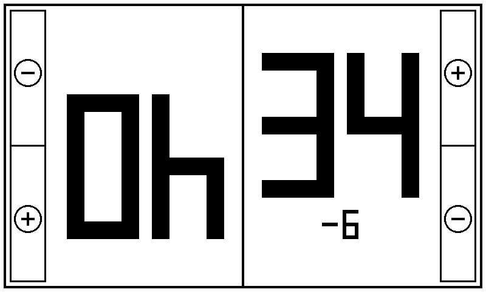
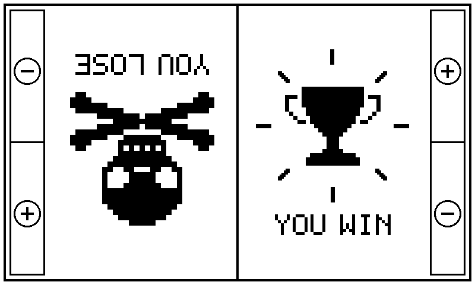
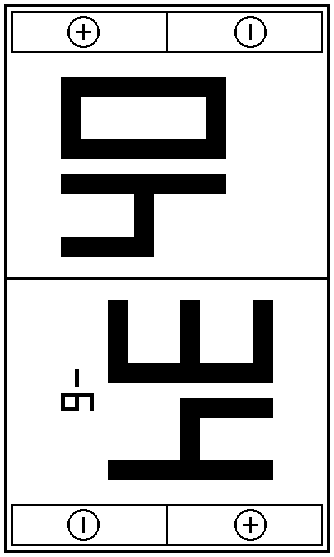
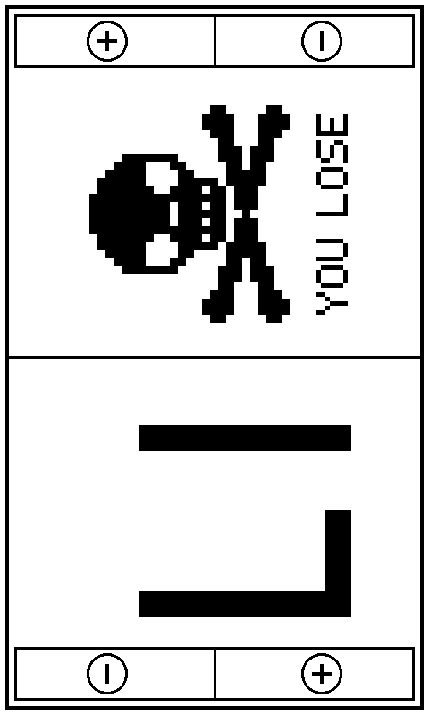
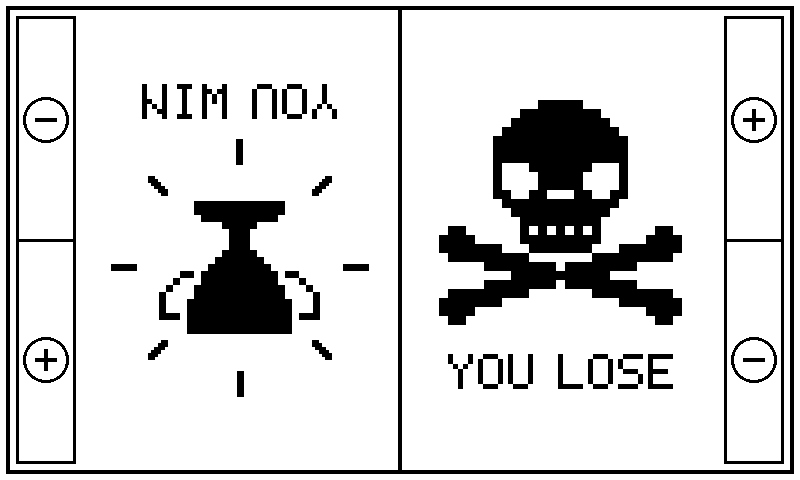
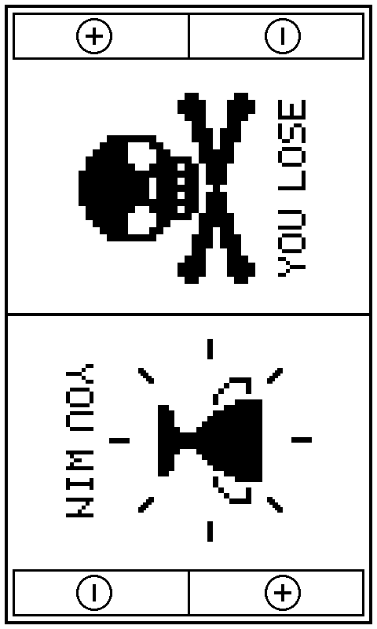
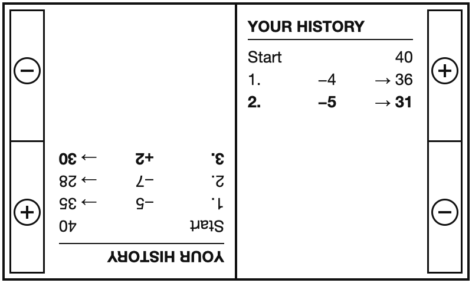

# Cross-Life-Point (Crosspoint 2.0 + Lifepoint Counter) for the Xteink X4 Pro (touch)

> **Untested build.** This version was built and checked (valid ESP32-S3 image), but it has
> **not been tried on a real X4 Pro yet**. Make a backup before flashing (see below).
> For the button-based Xteink X4, use the `lifepoints` branch and its releases instead
> ([LIFEPOINTS.md](./LIFEPOINTS.md)).

The X4 Pro has a touchscreen, a capacitive Home key, two small nav buttons and no front
buttons. This branch (`lifepoints-x4pro`) adds touch controls to LifePoints. Everything else in
CrossPoint stays unchanged, and on a device without touch the code behaves exactly like
the X4 version.

<p>
  
  
</p>

*Renders of the exact firmware drawing, as seen by the bottom player.*

---

## Controls

Each end of the screen has a framed band with two touch fields. From each player's own
seat, **−** is on the left and **+** is on the right.

| Action | How |
|---|---|
| −1 / +1 | Tap a − or + field |
| −5 / +5 | Hold a field for 0.6 seconds or longer, then lift |
| Cancel a press | Slide the finger out of the field before lifting |
| Show / hide the history | Hold the **Right** nav button for 1 second |
| Close the history | Tap any − or + field (no total changes) |
| Reset to 40/40 | Hold the **Left** nav button for 2 seconds (also clears the history) |
| Back to the home menu | Press the Home key |

**Touch is locked to the four fields.** Taps anywhere else (on the numbers, the divider)
do nothing, and the top-edge swipe that normally opens the control center is turned off
while LifePoints is open. The frontlight can still be switched with the power button.

Everything else works like the X4 version:

- Both players start at 40.
- 2 seconds after a player's last press, a small "−6" / "+2" under the total shows the change.
- A player at 0 gets a skull with crossed bones and "YOU LOSE"; 2 seconds later the other
  player gets a trophy with rays and "YOU WIN".
- Full refresh only when opening LifePoints and on reset; fast refresh otherwise.
- **History per player:** each half shows that player's own changes, "Start 40" at the top,
  the newest in bold at the bottom; with more than 9 changes the newest 9 stay.
- **Stays awake:** the device sleeps only after 20 minutes without input while LifePoints is
  open (a longer sleep setting is kept).

"Right" and "Left" are CrossPoint's names for the two nav buttons; which one sits where on
the case still has to be confirmed on a real X4 Pro.

## Screens

| Situation | Full screen | Player's view |
|---|---|---|
| Game in progress (bottom player just lost 6) |  |  |
| Top player reaches 0 |  |  (loser) |
| 2 seconds later |  |  (winner) |
| History (hold Right 1 s) | |  (bottom player lost 4, then 5) |

The minus signs in the circles run along the short side of the screen, so they read as a
minus for players looking at the device from the side.

---

## Install

Download `custom-x4pro.bin` from the X4 Pro release under **[Releases](../../releases)**.
It is an app image for address **0x10000** (ESP32-S3, 16 MB flash). Do **not** flash the
X4 `custom.bin` on an X4 Pro or the other way round: the chips are different.

**Option 1, SD card (easiest):** copy `custom-x4pro.bin` to the SD card, then on the device
open **Settings → System → SD Card Firmware Update** and select the file.

**Option 2, USB with esptool:** make a backup first, then:

```bash
esptool --chip esp32s3 write-flash 0x10000 custom-x4pro.bin
```

Backup and restore work like on the X4, with `--chip esp32s3`:

```bash
esptool --chip esp32s3 read-flash 0 0x1000000 backup_x4pro_16MB.bin
esptool --chip esp32s3 write-flash 0 backup_x4pro_16MB.bin
```

Do **not** upload the backup anywhere public: it can contain Wi-Fi passwords and login data.

## Build it yourself

```bash
pio run -e x4pro-gh_release
```

Output: `.pio/build/x4pro-gh_release/firmware.bin` (this is `custom-x4pro.bin`).

## What changed compared to the X4 version

| File | Change |
|---|---|
| `src/activities/lifepoints/LifePointsActivity.*` | touch fields with frames, release-inside-the-field rule, nav buttons for reset, rotated minus on touch devices |
| `src/activities/ActivityManager.cpp` | no control-center swipe while LifePoints is open |
| `docs/lifepoints/x4pro/` | screen renders for this guide |
