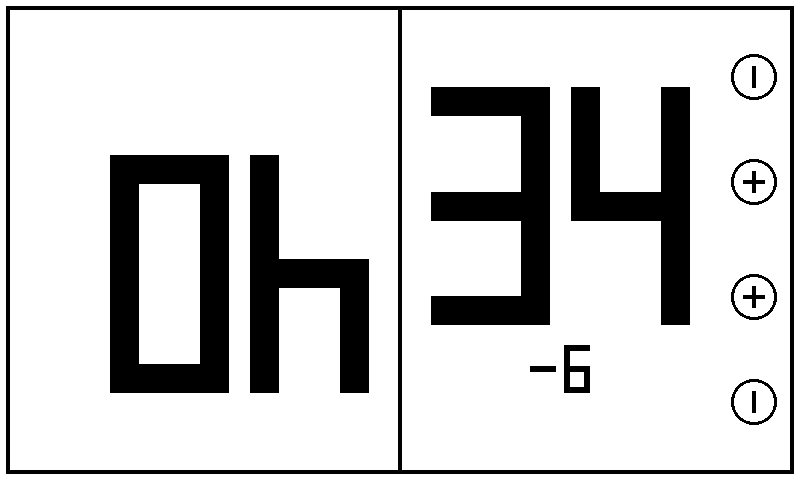
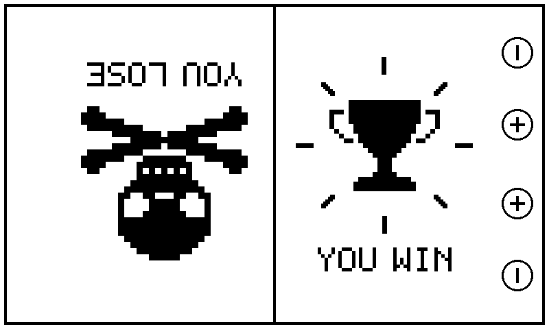
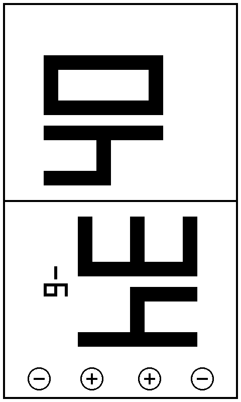
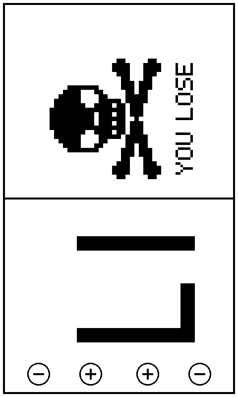
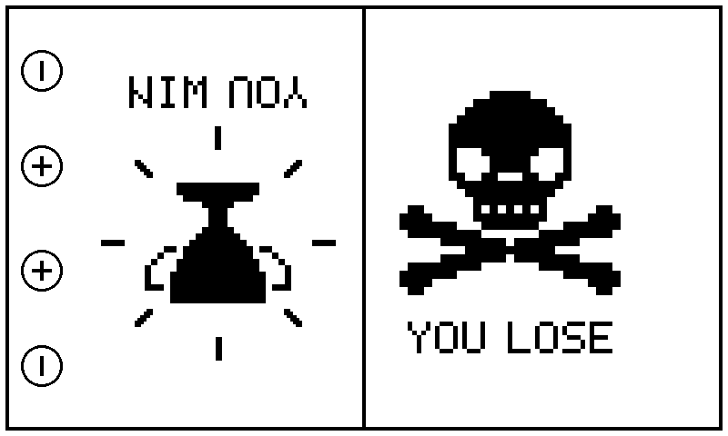
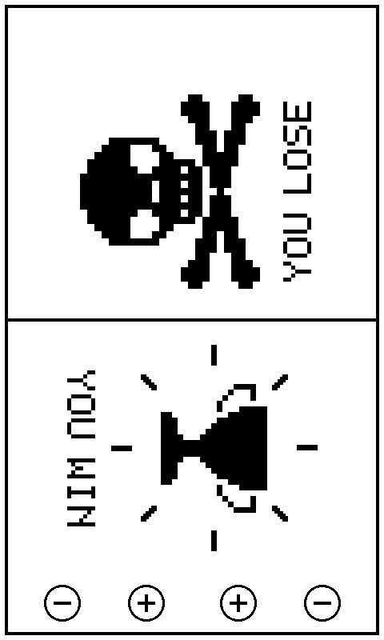
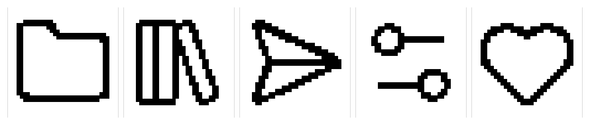

# CrossPoint + LifePoints

This fork is the official [CrossPoint Reader](https://github.com/crosspoint-reader/crosspoint-reader) 2.0.0
with **one extra menu entry: LifePoints**, a two-player life counter
(made for **Flesh and Blood**, but it works for any card game that tracks life).

Everything else in CrossPoint (reading, library, file transfer, settings, themes)
stays **unchanged**.

Tested on: **Xteink X4** (ESP32-C3, 800×480 e-ink, 16 MB flash).

This is an unofficial fork. It is not supported by the CrossPoint team.

<p>
  
  
</p>

*Screens as seen by the bottom player. These are renders of the exact firmware drawing, not photos.*

---

## What LifePoints does

- Two players, both start at **40** life.
- The device lies in **portrait** between the players, with the 4 front buttons at the bottom.
- **Top half** = top player, **bottom half** = bottom player, separated by a line.
- Huge black numbers, **rotated sideways** so each player can read their own total
  (top: 90° counter-clockwise, bottom: 90° clockwise).
- Small circles with **− + + −** right above the buttons, no other text.
- **Change indicator:** 2 seconds after the last button press, a small number under the total
  shows how much it changed in total (for example **−7** or **+2**). Presses in quick
  succession are added up. The indicator stays until that player changes their total again.
- **Game over:** when a player reaches 0, their half shows a **skull with crossed bones** and
  "YOU LOSE" right away. 2 seconds later the other player gets a **trophy with rays** and
  "YOU WIN". If the 0 was a mistake, pressing + brings the numbers back. If both players
  reach 0, both get a skull.
- The game state survives a quick trip to the home menu
  (but not sleep or a restart).

You find the entry at the bottom of the home menu ("LifePoints"), with an outline heart in front of it
in the **Lyra theme** (the stock Lucide "heart", same style as the other menu icons).
In the **Cover Grid theme** it is the heart in the bottom bar.

## Controls

Buttons 1–4 = the four front buttons **from left to right**.

| Button | Circle | Action |
|---|---|---|
| 1 | − | bottom player −1 |
| 2 | + | bottom player +1 |
| 3 | + | top player +1 |
| 4 | − | top player −1 |

- **Short press** = 1 point.
- **Hold (0.6 seconds or longer)** = 5 points, applied once on release.
- **Reset to 40/40:** **hold a side button for 1 second**.
- **Back to the home menu:** press **1, 4, 1, 4** quickly (within 3 seconds).
  Any life changes made by these presses are undone automatically.

**Screen refresh:**

| Situation | Refresh |
|---|---|
| Opening LifePoints | full (one strong flash) |
| Reset with the side button | full |
| Life total changes | fast |
| Change indicator appears | fast |
| Skull / trophy appears | fast |
| Button press with no effect (e.g. already at 0) | none |

After a lot of fast refreshes, faint ghosts of old numbers may remain.
A reset, or leaving and reopening LifePoints, cleans the screen again.

## Screens

All images are renders of the firmware's own drawing code (same pixel art, same layout).
The full-screen images show the device in portrait with the buttons at the bottom; the
"view" images are rotated to show what each player sees.

| Situation | Full screen | Player's view |
|---|---|---|
| Game in progress (bottom player just lost 6) |  |  |
| Top player reaches 0 |  |  (loser) |
| 2 seconds later |  |  (winner) |

Home menu icons, enlarged; only the heart (right) is new:



### Why reset with the side button?

The original plan was "press buttons 2 and 3 together". On the X4, however, all four front buttons
share **a single analog input** (a resistor ladder on one ADC pin). Two buttons pressed at once
produce a mixed value that is read as one single, wrong button. The side buttons use a separate
input, so they are detected reliably.

---

## Install

The ready-made firmware is available under **[Releases](../../releases)** as `custom.bin`.
It is an app image for address **0x10000** (not a full flash image).

### Option 1: via SD card (easiest)

1. Copy `custom.bin` to the X4's SD card.
2. On the device in CrossPoint: **Settings → System → SD Card Firmware Update**
   and select the file.

CrossPoint itself takes care of which app partition gets written.

### Option 2: via USB with esptool (Mac/PC)

**Make a backup first** (see below). Then:

```bash
esptool --chip esp32c3 write-flash 0x10000 custom.bin
```

Note: this only works directly if partition `app0` is currently active on the device.
After earlier online updates `app1` may be active; in that case option 1 is easier.

## Backup and restore

**Backup** of the full 16 MB flash (read-only, changes nothing):

```bash
esptool --chip esp32c3 --no-stub read-flash 0 0x1000000 backup_x4_16MB.bin
```

`--no-stub` is slower but was needed on the X4: with the fast stub loader, reading stopped
at address 0x140000 every time.

**Restore** (writes the device back to exactly its old state):

```bash
esptool --chip esp32c3 write-flash 0 backup_x4_16MB.bin
```

If the device does not respond: hold the power button, briefly press reset, release power
(download mode), then run the command again.

Do **not** upload the backup anywhere public: it can contain Wi-Fi passwords and login data.

---

## Build it yourself

Build with PlatformIO, environment `gh_release`:

```bash
pio run -e gh_release
```

Output: `.pio/build/gh_release/firmware.bin` (this is the `custom.bin`).

Two pitfalls on macOS:

- The project folder path must **not contain spaces** (ESP-IDF aborts otherwise).
- PlatformIO Core **6.2.0** fails with `No module named 'SCons.Tool.FortranCommon'`.
  Fix (same as the official CI): install core 6.1.19 into PlatformIO's own Python environment:
  ```bash
  ~/.platformio/penv/bin/python -m pip install "pioarduino==6.1.19"
  ```
  Then delete `.pio/libdeps/gh_release` once and build again.

## What changed in the code

| File | Change |
|---|---|
| `src/activities/lifepoints/LifePointsActivity.*` | **new**: the counter (buttons, display, refresh, game over) |
| `src/activities/lifepoints/LifePointsArt.h` | **new**: pixel art for skull and trophy, pixel font for YOU WIN / YOU LOSE |
| `src/components/icons/heart.h` | **new**: Lucide heart outline for Cover Grid and Lyra theme |
| `src/components/icons/customListIcons.h`, `src/components/UiAppHelpers.h` | Lucide heart outline for list menus |
| `docs/lifepoints/` | **new**: the screen renders used in this guide |
| `src/components/themes/BaseTheme.h`, `src/components/themes/lyra/LyraTheme.cpp` | new icon `Heart` |
| `src/activities/ActivityManager.h` | added menu entry `LIFEPOINTS` |
| `src/activities/home/HomeActivity.*` | menu entry in the home menu |
| `src/components/CoverGridHomeUi.*` | sixth icon (heart) in the Cover Grid |

Branches in this repo:

- `lifepoints` – this version (default)
- `base-2.0.0` – the unchanged official CrossPoint 2.0.0
- `develop` – the official repo's state at the time of the fork
